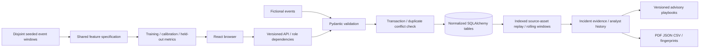

# Architecture
A modular monolith: React 19/TypeScript/Vite, React Router, Recharts, FastAPI, Pydantic v2, SQLAlchemy 2, Alembic, and SQLite/PostgreSQL. Ordinary CSS forms the design system; Tailwind was not needed for the small component library. NumPy handles feature matrices directly without a pandas dependency.

Tables: users, sessions, assets (parent relationship), events, incidents, incident_evidence, notes, audit, policies, ingestion_runs. Foreign keys are enforced, including SQLite PRAGMA activation. Event fingerprints cover canonical stored fields. Audit links include the previous record’s hash. Legacy `records` remains as a migration rollback copy; a completion marker prevents reset data from being re-imported on restart.

For each affected source/asset pair, ingestion replays its indexed history with bounded sliding windows. This is simpler than a streaming watermark/checkpoint system and handles late arrival deterministically, but replay cost still grows with that source’s retained history. Rolling cooldowns replace fixed buckets. If late events bridge episodes, evidence overlap coalesces incidents while preserving both histories and recording the merge in audit.

The default deployment is a single application process. A process lock serializes mutations and protects in-memory SQLite test connections. Multi-worker concurrent ingestion requires explicit database-level coordination; it is outside this release’s validated deployment. Sessions are stored in the database, while request-rate counters are per process.

Offline services use the same rule policy and feature specification. Twenty-five generated Python/browser fixtures verify detection IDs, rules, severities, evidence, and features. Offline model evaluation recomputes the baseline metrics from held-out features packaged by Python; Python-trained Isolation Forest results are labeled metadata, not browser training.
